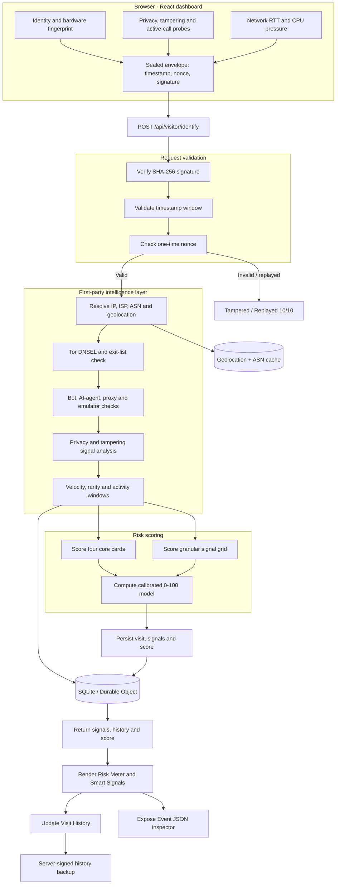

# Intel System

### Real-time Visitor Intelligence & Browser Fingerprinting

*Know the visitor. Understand the device. Inspect the network.*

## What it does

Intel System turns a browser visit into an explainable intelligence profile. It combines first-party identity signals, hardware and rendering fingerprints, network telemetry, privacy indicators, and behavioural context to assess whether a visitor is human, automated, private, proxied, or emulated.

Every analysis is performed through a signed first-party API request, scored across granular signals, stored as visit history, and rendered in a real-time dashboard.

## Why it’s different

- **First-party and transparent:** visitor signals are collected and processed through your own API, with no third-party tracking dependency.
- **Multi-layer analysis:** combines browser identity, hardware fingerprints, network intelligence, privacy settings, and behavioural signals.
- **Explainable scoring:** each signal has a visible status and score, while the server also produces a calibrated overall risk score.
- **Persistent visitor history:** recognizes returning visitors and preserves session, IP, location, and device context across visits.
- **Serverless-ready:** designed for Cloudflare Workers with SQLite-backed Durable Objects, while remaining deployable with Express.

## What it detects

| Area | What Intel System checks |
|---|---|
| Visitor identity | Persistent Visitor ID, Hardware ID, returning visitors, sessions, visit totals, observed IPs, and geolocation history |
| Incognito / private browsing | IndexedDB durability, OPFS flush timing, and storage quota behaviour |
| Bots and automation | User-Agent consistency, operator ASN, rDNS, Web Bot Auth, WebDriver, CDP, and headless-rendering signals |
| AI agents and crawlers | Google Gemini and Gemini Cloud Agent, Grok, Claude, Perplexity, ChatGPT / OpenAI, Muse, and verified Googlebot traffic, with operator and execution-mode attribution |
| Remote browser agents | Firecrawl, Browser Use, Skyvern, MultiOn, Hyperbrowser, Steel, Airtop, Notte, Lightpanda, and Browserless |
| VPN, proxy, and Tor | Tor exit nodes, Tor Browser clients, Tor relays, datacenter ASN, timezone mismatch, proxy headers, and forwarded-IP chains |
| Network classification | Verified crawler networks, AI-agent cloud networks, datacenter or hosting ASN, VPN / datacenter proxy, VPN / timezone relay, and standard ISP traffic |
| Virtual machines and emulators | GPU vendor/renderer, platform, touch points, screen dimensions, and emulator markers |
| Browser tampering | DevTools emulation, anti-detect browsers, replaced Navigator getters, and JavaScript-versus-HTTP User-Agent mismatches |
| Developer tools | Docked DevTools through outer/inner viewport differences |
| Active calls | WebRTC audio tracks, `navigator.audioSession`, and voice-routed AudioContext state |
| Privacy settings | Tor Browser RFP, letterboxed viewports, Brave Shields, and canvas anti-fingerprinting noise |
| Behaviour and rarity | Distinct IPs, linked sessions, countries, and events across 5-minute, 1-hour, and 24-hour windows; high activity at 20+ events in 24 hours and rare-device comparison against a 30-day baseline |

The four core cards and granular signal grid rate visits from `0/10` to `10/10`. The server computes both views, and the dashboard mirrors the same rules client-side so the displayed scores remain consistent.

<strong>Sealed request and tamper protection</strong>

Every payload includes a SHA-256 signature, a `±60 s` timestamp window, and a one-time nonce. Stale, modified, or replayed requests are reported as `Tampered / Replayed 10/10`.

Browser-tampering checks cross-reference the mobile User-Agent with `navigator.platform`, the JavaScript engine, `navigator.maxTouchPoints`, `outerWidth` versus `screen.width`, the unmasked WebGL renderer, `matchMedia` versus `screen.width`, replaced `Navigator.prototype` getters, and the JavaScript-versus-HTTP User-Agent. A genuine iPadOS `MacIntel` device with real touch points remains clean.

Proxy signals include `Proxy-Authorization`, `Proxy-Connection`, a non-CDN `Via` header, an upstream `Forwarded` address, and a three-hop public `X-Forwarded-For` chain. The dashboard identifies the proving header when proxy detection triggers.

## Dashboard

- **Identity overview:** visitor and hardware identity, returning-visitor state, visit totals, and observed locations.
- **Hardware & rendering entropy:** browser, OS, CPU, GPU, memory, display, fonts, emoji metrics, canvas stability, WebGL hashes, and math-vector attributes.
- **Smart Signals & threat analysis:** deterministic signal rows, four core risk cards, and a granular signal grid.
- **Network stability & CPU activity:** public IP, ISP, ASN, interactive Leaflet geolocation map, live RTT, jitter, failed HTTP probes, and Compute Pressure-based CPU activity.
- **Visit history:** persistent session, timestamp, IP, location, and device records; latest five visits by default with expand/collapse controls.
- **Event JSON inspector:** renders and copies the live API v4 payload, including raw device attributes.
- **Cursor attribution overlay:** appears only for non-human visitors. It identifies agents such as Gemini, Grok, Claude, Perplexity, ChatGPT, and Muse, while human visitors retain the native cursor.

## How it works

One signed payload goes in. The server verifies it, resolves the network, classifies the visitor, scores every signal, stores the visit, and returns the same evidence the dashboard renders.

## Try it

Open the [live demo](https://intel.adityahq.me) and select **Analyze my browser**.

| Test | What to observe |
|---|---|
| Normal browsing | Identity, device, network, and signal panels populate with a low-risk profile |
| Incognito or private window | Privacy and storage-related signals change |
| VPN or proxy | Network type, ASN, timezone, and proxy signals are reassessed |
| DevTools device emulation | Tampering and device-consistency signals respond immediately |
| Repeated visits | Visitor recognition, visit totals, and history update |

## Tech stack

## Deployment

Deployment, storage, and cost details are documented in [CLOUDFLARE.md](./CLOUDFLARE.md).