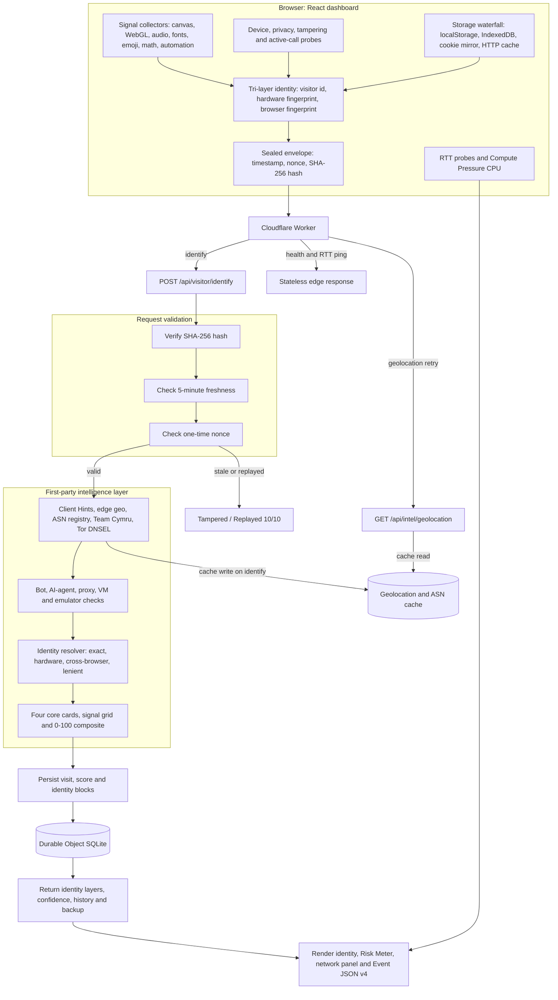

# Intel System

### Real-time Visitor Intelligence & Browser Fingerprinting

*Know the visitor. Understand the device. Inspect the network.*

## What it does

Intel System turns a browser visit into an explainable intelligence profile. It combines first-party identity signals, hardware and rendering fingerprints, network telemetry, privacy indicators, and behavioural context to assess whether a visitor is human, automated, private, proxied, or emulated.

Identity is resolved in three layers: a persistent Visitor ID, a deterministic hardware fingerprint, and a browser fingerprint. The server matches them through exact, hardware, cross-browser, and lenient modes, returns the winning mode with a calibrated confidence score, and records the visit as history.

Every analysis runs through a signed first-party API request, is scored across granular signals, and is rendered in a real-time dashboard.

## Why it's different

- **First-party and transparent:** visitor signals are collected and processed through your own API, with no third-party tracking dependency.
- **Tri-layer identity:** a persistent Visitor ID, a hardware-only fingerprint, and a browser-only fingerprint are matched independently, so a visitor is still recognised after a browser change while a genuinely new device stays new.
- **Multi-layer analysis:** combines browser identity, hardware fingerprints, network intelligence, privacy settings, and behavioural signals.
- **Explainable scoring:** each signal has a visible status and score, the four core cards rate `0/10` to `10/10`, and the API payload also carries a `0-100` composite with the velocity, rarity and tampering evidence behind it.
- **Persistent visitor history:** a storage waterfall (localStorage, IndexedDB, cookie mirror, HTTP cache) keeps the visitor ID through storage wipes, a server-signed backup restores history when the store is empty, and hardware-ID recovery covers private windows where DOM storage starts blank.
- **Serverless with a write budget:** only `POST /api/visitor/identify` writes to the Durable Object; health and RTT ping are answered statelessly, and every read and write degrades gracefully instead of returning a `500` when the daily write quota is exhausted.

### Local Worker verification

Verify the Worker locally with `node scripts/test-worker.mjs`, and build it with `npm run build` and `node scripts/build-worker.mjs`; see [CLOUDFLARE.md](./CLOUDFLARE.md#local-worker-verification).

## What it detects

| Area | What Intel System checks |
|---|---|
| Visitor identity | Persistent Visitor ID, hardware fingerprint, browser fingerprint, returning visitors, exact, hardware, cross-browser, and lenient matches, calibrated confidence, sessions, visit totals, observed IPs, and geolocation history |
| Incognito / private browsing | IndexedDB durability, OPFS flush timing, and storage quota behaviour |
| Bots and automation | User-Agent and Client Hints consistency, operator ASN, reverse DNS, WebDriver and CDP bindings, headless-rendering signals, and a weighted evidence gate so weak quirks never mark a person automated |
| AI agents and crawlers | ChatGPT-User, OAI-SearchBot, GPTBot, ChatGPT Agent, Codex, Gemini Deep Research, Google-Agent, Google NotebookLM, Claude-User, Claude-SearchBot, ClaudeBot, Claude Code, Claude Duet, Perplexity-User, PerplexityBot, Grok Bot, Meta-ExternalAgent, Meta-WebIndexer, Muse, Kimi-User, Cursor, Manus Agent, AGI Agent, Browserbase Agent, Anchor Browser, Notte Browser, Bedrock AgentCore, Cloudflare Browser Rendering, DuckAssistBot, Instinct, and verified Googlebot traffic, with operator and execution-mode attribution |
| Remote browser agents | Firecrawl, Browserbase, Browser Use, Skyvern, MultiOn, Hyperbrowser, Steel, Airtop, Notte, Lightpanda, Browserless, and managed scraping fleets |
| VPN, proxy, and Tor | Tor exit nodes, Tor Browser clients, Tor relays, datacenter ASN, timezone mismatch, proxy headers, forwarded-IP chains, and a Tor relay country fallback |
| Network classification | Tor anonymity network, AI-agent cloud network, datacenter or hosting ASN, VPN or proxy relay on a residential line, cellular, satellite, and standard ISP traffic |
| Hardware and rendering entropy | CPU cores, memory, GPU vendor and renderer, max texture size, canvas stability, WebGL limits and hashes, audio fingerprint, font inventory, font preferences, emoji metrics, and math vectors |
| Virtual machines and emulators | GPU vendor and renderer, platform, touch points, screen dimensions, and emulator markers |
| Browser tampering | DevTools device emulation, anti-detect browsers, replaced Navigator getters, and JavaScript versus HTTP User-Agent or Client Hints mismatches |
| Developer tools | Docked DevTools through outer and inner viewport differences |
| Active calls | WebRTC audio tracks, `navigator.audioSession`, and voice-routed AudioContext state |
| Privacy settings | Tor Browser RFP, letterboxed viewports, Brave Shields, and canvas anti-fingerprinting noise |
| Behaviour and rarity | Distinct IPs, linked sessions, countries, and events across 5-minute, 1-hour, and 24-hour windows; high activity at 20+ events in 24 hours and rare-device comparison against a 30-day baseline with at least 20 visits |

The four core cards and the granular signal grid rate visits from `0/10` to `10/10`. The server computes both views, and the dashboard mirrors the same rules client-side so the displayed scores stay consistent. The payload also exposes the `0-100` composite and the velocity, rarity and tampering inputs behind it.

<strong>Sealed request and tamper protection</strong>

Every payload includes a SHA-256 integrity hash over a canonical `INTEL_ENVELOPE_V1` string, a 5-minute freshness window, and a one-time nonce with a 15-minute replay cache. Stale, modified, or replayed requests are reported as `Tampered / Replayed 10/10`.

Browser-tampering checks cross-reference the mobile User-Agent with `navigator.platform`, the JavaScript engine, `navigator.maxTouchPoints`, `outerWidth` versus `screen.width`, the unmasked WebGL renderer, `matchMedia` versus `screen.width`, replaced `Navigator.prototype` getters, and the JavaScript-versus-HTTP User-Agent. High-entropy Client Hints (`Sec-CH-UA-Platform-Version`, `Sec-CH-UA-Arch`, `Sec-CH-UA-Model`, and `Sec-CH-UA-Full-Version-List`) are normalised on the server, so Windows 11 is not mistaken for Windows 10 and Android versions come from the platform version rather than the reduced UA string. A genuine iPadOS `MacIntel` device with real touch points remains clean.

Proxy signals include `Proxy-Authorization`, `Proxy-Connection`, a non-CDN `Via` header, an upstream `Forwarded` address, and a three-hop public `X-Forwarded-For` chain. The dashboard identifies the proving header when proxy detection triggers.

Only `POST /api/visitor/identify` writes to storage. `GET /api/health`, `GET /api/network/ping`, and `GET /api/intel/geolocation` perform no row writes, and a blocked daily write quota returns a normal `200` with cached or signed-backup data instead of an error.

## Dashboard

- **Identity header:** visitor and hardware identity, returning or first-seen state, calibrated confidence with version, the winning match mode, and the consistency verdict.
- **Risk meter:** the Suspect Score and risk tier, next to the four core cards for incognito, automation, network, and virtualisation.
- **Visitor overview:** device tiles for browser, OS and device, display, locale and timezone, active session, first and last seen, plus public IP, location, ISP and ASN, recognition source, and phone model when the device exposes one.
- **Hardware & rendering entropy:** browser, OS, CPU, GPU, memory, display, fonts, emoji metrics, canvas stability, WebGL hashes, and math-vector attributes.
- **Smart Signals & threat analysis:** deterministic signal rows, four core risk cards, and a granular signal grid.
- **Network stability & CPU activity:** public IP, ISP, ASN, interactive Leaflet geolocation map, live RTT, jitter, packet loss, failed HTTP probes, and Compute Pressure-based CPU activity on desktop Chromium.
- **Visit history:** persistent session, timestamp, IP, location, and device records; latest five visits by default with expand/collapse controls.
- **Event JSON inspector:** renders and copies the live API v4 payload, including raw device attributes and identity layers.
- **Cursor attribution overlay:** appears only for non-human visitors. It identifies agents such as Gemini, Grok, Claude, Perplexity, ChatGPT, and Muse, while human visitors retain the native cursor.

## How it works

One signed payload goes in. The Worker verifies it, resolves the network through edge headers, a bundled ASN registry, and Team Cymru DNS, classifies the visitor, resolves identity through the fingerprint ladder, scores every signal, stores the visit, and returns the same evidence the dashboard renders. Health, RTT ping, and history reads are answered without a row write.

## Try it

Open the [live demo](https://intel.adityahq.me) and select **Analyze my browser**.

| Test | What to observe |
|---|---|
| Normal browsing | Identity, device, network, and signal panels populate with a low-risk profile |
| Incognito or private window | Privacy and storage-related signals change |
| VPN or proxy | Network type, ASN, timezone, and proxy signals are reassessed |
| DevTools device emulation | Tampering and device-consistency signals respond immediately |
| Repeated visits | Visitor recognition, visit totals, and history update |
| Reload in a second browser | The hardware fingerprint can still resolve the same visitor through a cross-browser match |

## Tech stack

## Deployment

Deployment, storage, and cost details are documented in [CLOUDFLARE.md](./CLOUDFLARE.md). Only `/api/visitor/*` and `/api/intel/geolocation` reach the Durable Object; `/api/health` and `/api/network/ping` are answered statelessly, so periodic monitors and the 5-second RTT probe never consume row writes.
