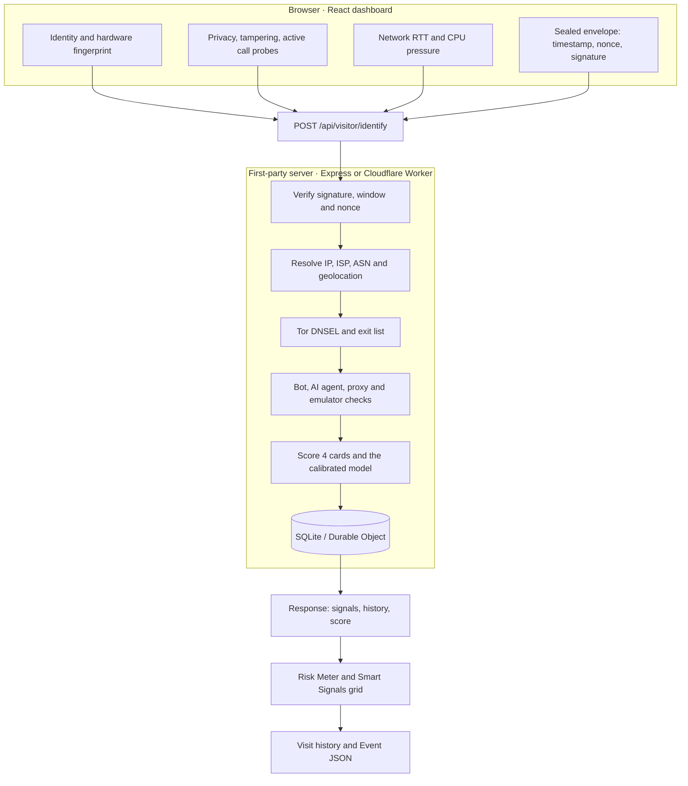

# Intel System

### Real-time Visitor Intelligence & Browser Fingerprinting

*Know the visitor. Understand the device. Inspect the network.*

Intel System is a first-party visitor intelligence dashboard that brings browser identity, hardware fingerprinting, network telemetry, and threat signals into one interface.

## How it works

One signed payload goes in. The server verifies it, resolves the network, classifies the visitor, scores every signal, stores the visit and returns the same evidence the dashboard renders.

## Features

### Visitor intelligence
- Persistent Visitor ID (`vid_`) and Hardware ID (`hwid_`).
- Returning visitor and session recognition.
- Visit totals, observed IPs and geolocation history.
- Hardware-based identity recovery when cookies are cleared.

### Threat analysis

Four core cards and a granular grid rate every visit from `0/10` to `10/10`. The server computes both, and the dashboard mirrors the same rules client-side, so the tiles and the meter never disagree.

| Signal | Evidence used | Score |
|---|---|---|
| Incognito / Private Browsing | IndexedDB strict-commit durability, OPFS flush timing, quota headroom | `0/10` or `4/10` |
| Bot & Automation Detection | User-Agent, operator ASN, rDNS, Web Bot Auth, WebDriver, CDP, headless rendering | `0`, `2`, `8`, `9` or `10/10` |
| VPN / Proxy & Network Type | Tor DNSEL, cached exit list, datacenter ASN, timezone mismatch, proxy headers | `0` to `10/10` |
| Virtual Machine & OS Integrity | GPU vendor and renderer, platform, touch points, screen width, emulator markers | `0` to `10/10` |

- **Sealed request envelope**: every payload carries a SHA-256 signature, a `±60 s` timestamp window and a one-time nonce. Stale, modified or replayed requests report `Tampered / Replayed 10/10`.
- **Browser tampering**: DevTools device emulation and anti-detect browsers are caught by cross-checking a mobile User-Agent against `navigator.platform`, the JavaScript engine, `navigator.maxTouchPoints`, `outerWidth` versus `screen.width`, the unmasked WebGL renderer, `matchMedia` versus `screen.width`, replaced `Navigator.prototype` getters, and the JS versus HTTP User-Agent. A genuine iPadOS `MacIntel` device with real touch points stays clean.
- **Docked DevTools**: a `200 px` outer/inner viewport delta reports `Developer Tools: Yes`.
- **Proxy detection**: `Proxy-Authorization`, `Proxy-Connection`, a non-CDN `Via` header, an upstream `Forwarded` address, or a three-hop public `X-Forwarded-For` chain reports `Proxy Detection: Yes` with the proving header.
- **Active call detection**: a connected WebRTC audio track, `navigator.audioSession` or a voice-routed `AudioContext` detects an in-progress call. The row is pruned where call state cannot be observed.
- **Privacy settings**: Tor Browser RFP, letterboxed viewports, Brave Shields and canvas anti-fingerprinting noise.
- **Velocity and rarity**: SQLite windows over `5 minutes`, `1 hour` and `24 hours` count distinct IPs, linked sessions, countries and events. `High-Activity Device` trips at 20+ events in 24 hours, and `Rare Device` compares the configuration against a 30-day baseline.
- **Remote browser agents**: Firecrawl, Browser Use, Skyvern, MultiOn, Hyperbrowser, Steel, Airtop, Notte, Lightpanda and Browserless are attributed by name, while signed cloud browsers are verified through Web Bot Auth.

### Smart Signals grid and risk score
- One deterministic row per signal, with plain statuses such as `Not detected`, `You are incognito`, `You are using a VPN` and `Your IP is a Tor exit node`.
- Every visible score is `0/10`. The server also publishes the calibrated additive `0/100` score in the event payload. Weights are clamped: bot 45, replay 35, tampering 25, VPN 14 plus 4 for multiple methods, blocklist 12, virtual machine 12, proxy 10, simulator 10, active call 10, privacy settings 8, incognito 6, high activity 6, developer tools 5, rare device 4.
- The dashboard stacks the identity overview, then Hardware & Rendering Entropy, then Smart Signals & Threat Analysis, then Network Stability and CPU Activity side by side, then Visit History and the Event JSON inspector.
- `Analyze my browser` re-runs collection without a page reload, so a DevTools device preset is reflected immediately.
- The Event JSON inspector at `#raw-json` renders and copies the live API v4 payload, including raw device attributes (fonts, emoji metrics, canvas stability, WebGL hashes, math vector).
- The cursor overlay appears for non-human visitors only. A human keeps the native cursor with no pill and no listeners. Remote browser agents get a branded pill, and agents that click or focus without moving a pointer are attributed at the interacted element.

### Network & device intelligence
- Public IP, ISP, ASN and verified geolocation on an interactive Leaflet map.
- Browser, OS, CPU, GPU, memory and display details.
- Live RTT, jitter and failed-HTTP-probe monitoring on a fixed `0-1000 ms` axis, paused when the tab is hidden or offline.
- CPU pressure through the W3C Compute Pressure API, with a 1 Hz heartbeat so a steady load never freezes the timeline. The panel is pruned on mobile and unsupported browsers.

### Visit history
- Persistent first-party visit records with session, timestamp, IP, location and device details.
- Latest five visits by default, with `Show next 5 visits (+5)` and `Collapse to latest 5`.
- Server-signed history backup for serverless continuity.

> Browser fingerprinting and threat detection rely on heuristic signals. Results can vary with browser privacy settings, proxies, extensions and platform capabilities.

Deployment, storage and cost details are documented in [CLOUDFLARE.md](./CLOUDFLARE.md).

## Tech

React 19 · TypeScript · Tailwind CSS v4 · Vite · Express · Cloudflare Workers · SQLite-backed Durable Objects · Leaflet
